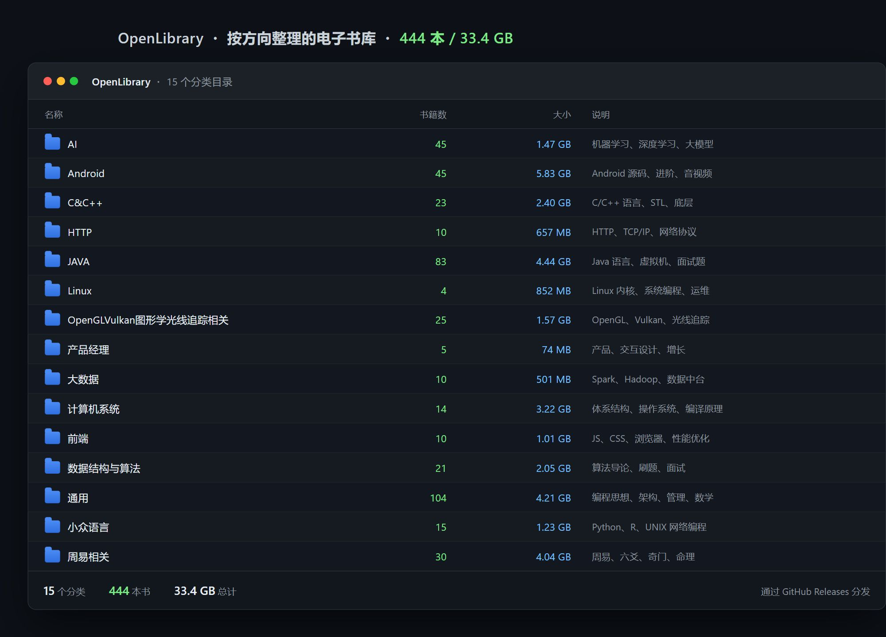

# 免费开源

一个按方向整理的计算机 / 互联网电子书库，共 **444** 本，**33.43 GB**。

书籍不放在 Git 仓库里（单文件动辄数百 MB，会撑爆仓库），全部通过 **GitHub Releases** 分发，点开即下，无需注册、无需客户端。



## 怎么下载

每本书的附件名是它内容的 **MD5**，这样不同人上传的同一本书不会重复，也方便你核对有没有下全。真实书名和 MD5 的对应关系就在下面的分类页里。

```
https://github.com/NoGirlfriendFoundException/OpenLibrary/releases/download/<分类标签>/<md5>.pdf
```

| 分类 | 数量 | 体积 | Release 标签 | 书单 |
|---|---:|---:|---|---|
| **Android** | 45 | 5.83 GB | [`android`](https://github.com/NoGirlfriendFoundException/OpenLibrary/releases/tag/android) | [查看书单](books/android.md) |
| **Java** | 83 | 4.44 GB | [`java`](https://github.com/NoGirlfriendFoundException/OpenLibrary/releases/tag/java) | [查看书单](books/java.md) |
| **通用 / 职业素养** | 103 | 4.21 GB | [`general`](https://github.com/NoGirlfriendFoundException/OpenLibrary/releases/tag/general) | [查看书单](books/general.md) |
| **周易 / 术数** | 30 | 4.04 GB | [`zhouyi`](https://github.com/NoGirlfriendFoundException/OpenLibrary/releases/tag/zhouyi) | [查看书单](books/zhouyi.md) |
| **计算机系统** | 14 | 3.22 GB | [`system`](https://github.com/NoGirlfriendFoundException/OpenLibrary/releases/tag/system) | [查看书单](books/system.md) |
| **C / C++** | 23 | 2.40 GB | [`cpp`](https://github.com/NoGirlfriendFoundException/OpenLibrary/releases/tag/cpp) | [查看书单](books/cpp.md) |
| **数据结构与算法** | 21 | 2.00 GB | [`algo`](https://github.com/NoGirlfriendFoundException/OpenLibrary/releases/tag/algo) | [查看书单](books/algo.md) |
| **图形学 / 渲染** | 25 | 1.57 GB | [`graphics`](https://github.com/NoGirlfriendFoundException/OpenLibrary/releases/tag/graphics) | [查看书单](books/graphics.md) |
| **AI / 机器学习** | 45 | 1.47 GB | [`ai`](https://github.com/NoGirlfriendFoundException/OpenLibrary/releases/tag/ai) | [查看书单](books/ai.md) |
| **其他语言** | 15 | 1.20 GB | [`niche-lang`](https://github.com/NoGirlfriendFoundException/OpenLibrary/releases/tag/niche-lang) | [查看书单](books/niche-lang.md) |
| **前端 / Web** | 10 | 0.99 GB | [`frontend`](https://github.com/NoGirlfriendFoundException/OpenLibrary/releases/tag/frontend) | [查看书单](books/frontend.md) |
| **Linux** | 4 | 851.6 MB | [`linux`](https://github.com/NoGirlfriendFoundException/OpenLibrary/releases/tag/linux) | [查看书单](books/linux.md) |
| **HTTP / 网络** | 10 | 657.1 MB | [`http`](https://github.com/NoGirlfriendFoundException/OpenLibrary/releases/tag/http) | [查看书单](books/http.md) |
| **大数据** | 10 | 500.7 MB | [`bigdata`](https://github.com/NoGirlfriendFoundException/OpenLibrary/releases/tag/bigdata) | [查看书单](books/bigdata.md) |
| **产品 / 运营** | 5 | 73.7 MB | [`product`](https://github.com/NoGirlfriendFoundException/OpenLibrary/releases/tag/product) | [查看书单](books/product.md) |
| **其他** | 1 | 17.6 MB | [`other`](https://github.com/NoGirlfriendFoundException/OpenLibrary/releases/tag/other) | [查看书单](books/other.md) |

## 已收录的目录

```text
OpenLibrary/
├─ Android/
├─ JAVA/
├─ 通用/
├─ 周易相关/
├─ 计算机系统/
├─ C&C++/
├─ 数据结构与算法/
├─ OpenGLVulkan图形学光线追踪相关/
├─ AI/
├─ 小众语言/
├─ 前端/
├─ Linux/
├─ HTTP/
├─ 大数据/
├─ 产品经理/
└─ 毛选东选集-静火版本.pdf   （放在根目录）
```

## 全部书籍索引

- [Android](books/android.md) ・ 45 本 ・ 5.83 GB ・ Android 源码、进阶、音视频
- [Java](books/java.md) ・ 83 本 ・ 4.44 GB ・ Java 语言、虚拟机、面试题
- [通用 / 职业素养](books/general.md) ・ 103 本 ・ 4.21 GB ・ 编程思想、架构、管理、数学
- [周易 / 术数](books/zhouyi.md) ・ 30 本 ・ 4.04 GB ・ 周易、六爻、奇门、命理
- [计算机系统](books/system.md) ・ 14 本 ・ 3.22 GB ・ 体系结构、操作系统、编译原理
- [C / C++](books/cpp.md) ・ 23 本 ・ 2.40 GB ・ C 与 C++ 语言、STL、底层
- [数据结构与算法](books/algo.md) ・ 21 本 ・ 2.00 GB ・ 算法导论、刷题、面试
- [图形学 / 渲染](books/graphics.md) ・ 25 本 ・ 1.57 GB ・ OpenGL、Vulkan、光线追踪
- [AI / 机器学习](books/ai.md) ・ 45 本 ・ 1.47 GB ・ 机器学习、深度学习、大模型相关
- [其他语言](books/niche-lang.md) ・ 15 本 ・ 1.20 GB ・ Python、R、UNIX 网络编程等
- [前端 / Web](books/frontend.md) ・ 10 本 ・ 0.99 GB ・ JS、CSS、浏览器、性能优化
- [Linux](books/linux.md) ・ 4 本 ・ 851.6 MB ・ Linux 内核、系统编程、运维
- [HTTP / 网络](books/http.md) ・ 10 本 ・ 657.1 MB ・ HTTP、TCP/IP、网络协议
- [大数据](books/bigdata.md) ・ 10 本 ・ 500.7 MB ・ Spark、Hadoop、数据中台
- [产品 / 运营](books/product.md) ・ 5 本 ・ 73.7 MB ・ 产品经理、交互设计、增长
- [其他](books/other.md) ・ 1 本 ・ 17.6 MB ・ 放在根目录、未归类的书

## 校验下载是否完整

```bash
# 单个文件
certutil -hashfile 文件名.pdf MD5     # Windows
md5sum 文件名.pdf                      # Linux / macOS
```

## 说明

- 所有书籍版权归原作者与出版社所有，本项目仅作索引与学习交流，**请勿用于商业用途**。
- 如有侵权，请开 Issue 或邮件联系，会立即移除对应附件。
- 仓库内的 Markdown 与截图以 [LICENSE](LICENSE) 授权；书籍内容不在授权范围内。
